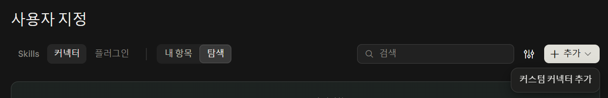
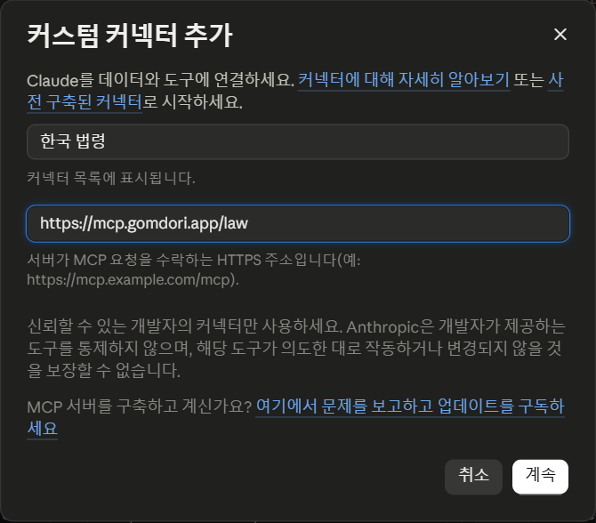
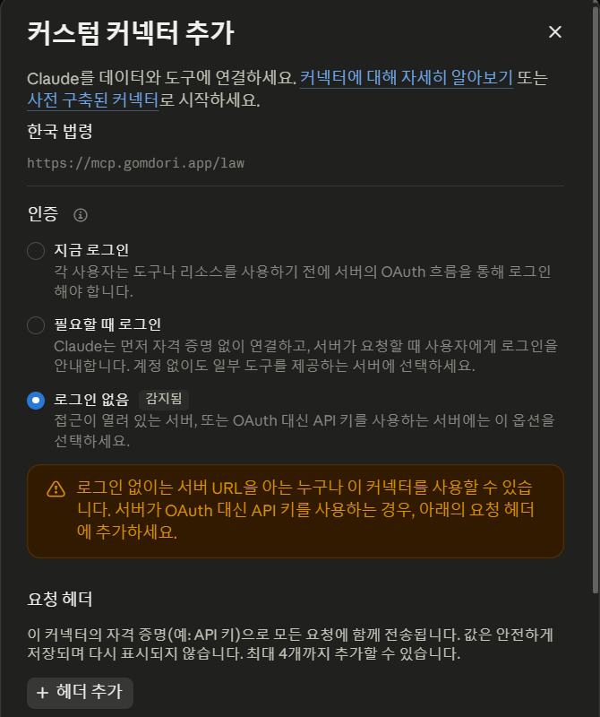
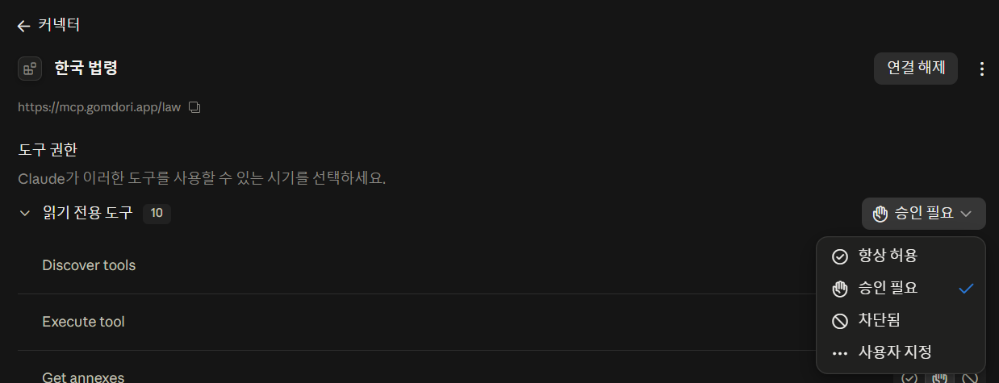
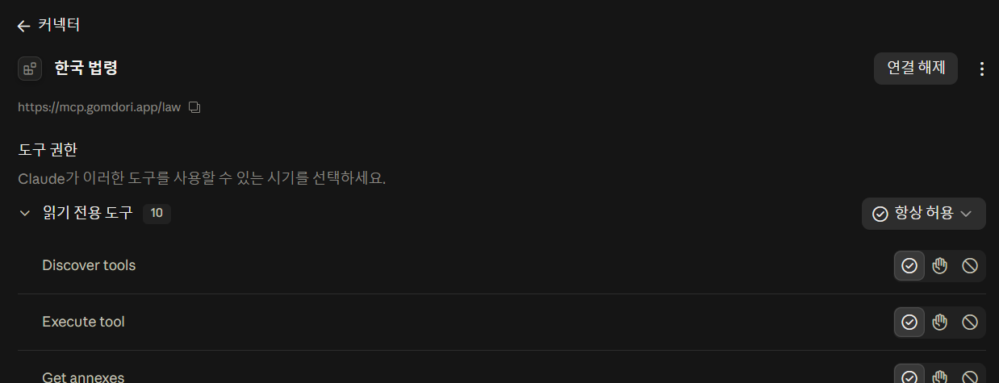
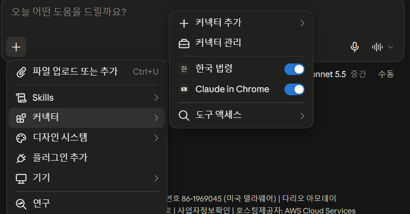
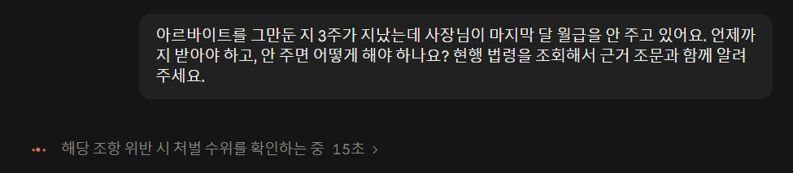
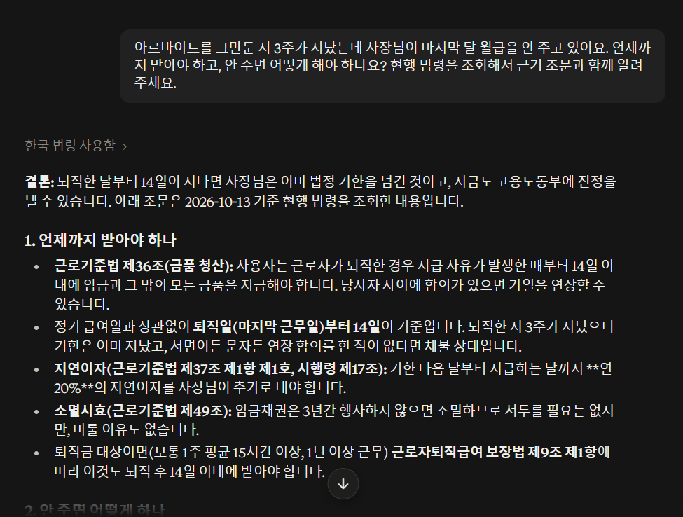
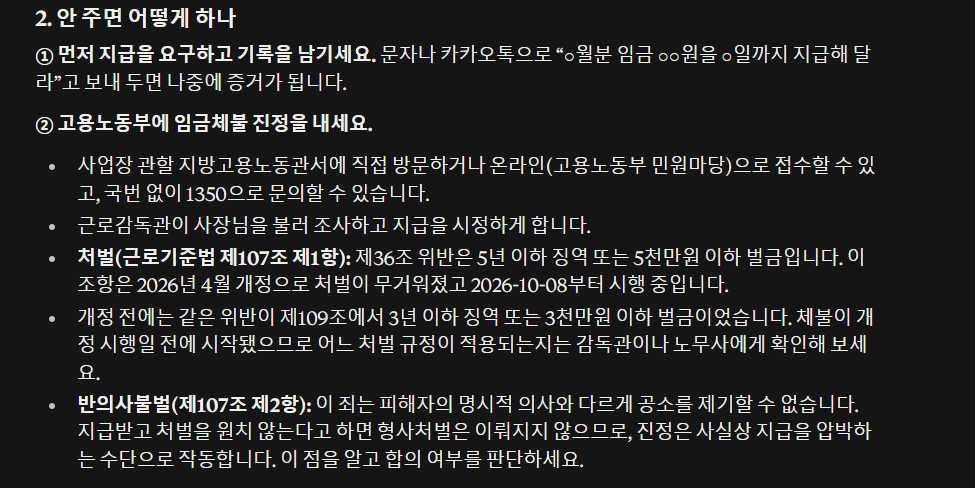

# 클로드에 'AI 법률 비서' 연결하기 (초보자용, 무료 계정 가능)

> 📄 **PDF로 받기:** [ai_lawyer_guide.pdf 바로 다운로드](https://github.com/AI-skill-notes/resources/raw/main/episodes/2026-10-14_ai-lawyer-guide/ai_lawyer_guide.pdf) (13쪽, 0.9MB) · [브라우저에서 보기](ai_lawyer_guide.pdf)

클로드에 법제처 국가법령정보를 연결하면, 질문할 때마다 **지금 시행 중인 법 조문 원문**을 직접 찾아보고 답합니다.
쓰는 도구는 공무원이 만든 오픈소스 [korean-law-mcp](https://github.com/chrisryugj/korean-law-mcp)(MIT 라이선스)입니다. AI스킬노트가 만든 도구가 아니고, 제휴도 없습니다.

> ⚠️ 이 가이드는 일반적인 법률 정보를 찾는 방법입니다. 법률 자문이 아닙니다. 실제 분쟁은 대한법률구조공단(☎132), 고용노동부(☎1350), 소비자상담센터(☎1372)에 함께 물어보세요.

---

## 왜 연결해야 하나요? (우리가 직접 해 본 결과)

2026년 10월 13일, 클로드 코드(Opus 5.5)에 같은 질문 3개를 **연결 없이 한 번, 연결하고 한 번** 물었습니다.

| 질문 | 연결 없이 | 연결하고 |
|---|---|---|
| 알바 월급을 3주째 못 받았어요 | 처벌 조항을 **제109조, 3년 이하 징역·3천만원 이하 벌금**으로 답함 | **제107조, 5년 이하 징역·5천만원 이하 벌금**으로 답함 |
| 전세 보증금을 안 돌려줘요 | 절차와 조문 대부분 맞음 | 조문 원문을 하나씩 확인하고 답함 |
| 온라인 쇼핑 환불을 거절당했어요 | 조문 대부분 맞음, "개정됐을 수 있으니 확인하라"고 덧붙임 | 현행 시행본에서 원문을 인용함 |

- 근로기준법은 2026년 4월 7일 개정되어 **10월 8일부터 시행**됐습니다. 임금 체불 처벌이 제107조로 옮겨지면서 무거워졌습니다(법제처 국가법령정보 조회, 10/13).
- 연결하지 않은 AI는 학습한 시점의 법을 기억으로 답합니다. 그래서 **최근에 바뀐 법**에서 틀리기 쉽습니다.
- 결과 원문: 이 폴더의 [`test/`](test/) (질문 3개와 연결 전후 답변 전문).

---

## 방법 1. claude.ai(웹·앱)에 연결하기 — 설치 없음, 무료 계정 가능

공식 도움말: 무료(Free) 요금제도 직접 추가하는 커넥터(커스텀 커넥터)를 **1개까지** 쓸 수 있습니다.
([Anthropic 도움말](https://support.claude.com/en/articles/11175166-getting-started-with-custom-connectors-using-remote-mcp): "Free users are limited to one custom connector.")

### 1단계. 커넥터 추가하기 (주소 한 줄, 가입·키 필요 없음)
1. claude.ai 왼쪽 메뉴에서 **사용자 지정** → 위쪽 **커넥터** 탭 → 오른쪽 위 **+ 추가** → **커스텀 커넥터 추가**를 누릅니다.
   
2. 이름 칸에 `한국 법령`, 아래 칸(MCP 서버 URL)에 `https://mcp.gomdori.app/law` 를 넣고 **계속**을 누릅니다.
   
3. 인증 화면에서 **로그인 없음**에 '감지됨'이 붙어 선택돼 있으면 그대로 두고, 아래로 내려 **추가**를 누릅니다.
   
4. 다음 화면에서 **연결**을 누르면 "한국 법령에 연결되었습니다"가 뜹니다.

### 2단계. 매번 묻지 않게 '항상 허용'으로
- 같은 화면의 **읽기 전용 도구 10** 오른쪽 **승인 필요**를 눌러 **항상 허용**으로 바꿉니다. 법령을 읽기만 하는 도구라 이렇게 두어도 됩니다.
  
  
- 새 대화 입력창의 **+** → **커넥터**에서 **한국 법령** 스위치가 켜져 있는지 확인합니다.
  

### 3단계. 이렇게 물어보세요
> "아르바이트를 그만둔 지 3주가 지났는데 사장님이 마지막 달 월급을 안 주고 있어요. 언제까지 받아야 하고, 안 주면 어떻게 해야 하나요? **현행 법령을 조회해서** 근거 조문과 함께 알려 주세요."

'현행 법령을 조회해서'를 넣으면 연결한 도구를 확실히 씁니다.

### 실제로 물어본 화면 (claude.ai, Sonnet 5.5, 2026-10-13)
질문을 보내면 '한국 법령 사용함'이 뜨고, 조문을 직접 조회한 뒤 답합니다. 처벌 조항이 10/8 시행된 개정법(제107조) 기준으로 나오고, 개정 전 조항(제109조)과의 차이까지 짚었습니다.




---

## 방법 2. 클로드 코드에 연결하기

터미널에 한 줄:
```bash
claude mcp add --transport http korean-law "https://mcp.gomdori.app/law"
```
그다음 `claude mcp list` 로 `korean-law ... ✔ Connected` 가 보이는지 확인합니다(2026-10-14 확인).

플러그인으로 설치해도 됩니다(설치 중에 인증키를 물으면 부록을 보세요):
```
/plugin marketplace add chrisryugj/korean-law-mcp
/plugin install korean-law@korean-law-marketplace
```

---

## 복사해 쓰는 질문 4개 (모두 실제로 돌려 본 질문)
끝에 "현행 법령을 조회해서 근거 조문과 함께 알려 주세요."를 붙여서 보내세요.
1. 알바 월급을 퇴사 후 3주째 못 받았어요. 언제까지 받아야 하고 어떻게 해야 하나요?
2. 전세 계약이 끝났는데 집주인이 다음 세입자가 들어와야 보증금을 준대요. 할 수 있는 일을 순서대로 알려 주세요.
3. 온라인에서 산 옷을 포장도 안 뜯었는데 '단순 변심 환불 불가'래요. 환불받을 수 있나요?
4. 헬스장을 3개월 만에 그만두려는데 환불을 안 해 준대요.

## 답을 받은 뒤 확인하는 3단계
1. 답에 나온 **법 이름과 조 번호**를 그대로 [국가법령정보센터](https://www.law.go.kr)에서 검색합니다.
2. 조문 위에 적힌 **시행일**이 오늘보다 앞인지 봅니다(현행인지).
3. 금액·기한·처벌 수위처럼 숫자가 나온 문장은 원문과 한 번 더 맞춰 봅니다.

## 부록. 막힐 때만: 내 인증키 넣기 (무료, 선택)
주소만 넣으면 키 없는 사용자 모두가 공용 한도를 나눠 씁니다. '요청이 너무 많다(429)'가 자주 뜨면 내 키를 받아 주소 끝에 붙이세요.
1. [open.law.go.kr](https://open.law.go.kr) 에 회원가입합니다.
2. 로그인한 뒤 **Open API 사용 신청**을 합니다. 신청서에 적은 값이 인증키(OC)가 됩니다.
3. 커넥터 주소를 `https://mcp.gomdori.app/law?oc=내인증키` 로 바꿉니다.
- 문의: 법제처 Open API 02-2109-6446

## 알아 둘 점
- **빠른 연결 주소(mcp.gomdori.app)** 는 도구 제작자가 운영하는 서버입니다. 인증키와 질문이 그 서버를 거칩니다. 민감한 개인정보(주민번호, 실명, 주소)는 질문에 넣지 마세요.
- 챗GPT의 외부 도구(MCP) 연결은 공식 도움말 기준 기업·교육용 요금제에서 시험 중이라, 이 가이드는 클로드만 다룹니다.

## 안 될 때
| 증상 | 해결 |
|---|---|
| 답에 조문 조회 흔적이 없다 | 질문에 '현행 법령을 조회해서'를 넣는다 / 커넥터가 켜져 있는지 확인 |
| 커넥터를 하나 더 못 넣는다 | 무료 요금제는 1개까지. 다른 커스텀 커넥터를 끄거나 지운다 |
| 오류 429 | 공용 한도에 요청이 몰린 것. 잠시 뒤 다시, 자주 뜨면 부록대로 내 키 넣기 |

---
출처: korean-law-mcp README(v4.15.7, 2026-10-11), Anthropic 도움말 11175166, 법제처 국가법령정보(조회 2026-10-13). 이 문서는 MIT 라이선스로 자유롭게 쓰셔도 됩니다.
