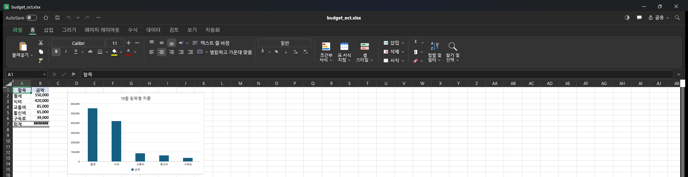

# MS 오피스 대신 평생 무료로 쓰는 앱 3개 (워드·엑셀·파워포인트)

> 📄 **PDF로 받기:** [free_office_apps_guide.pdf 바로 다운로드](https://github.com/AI-skill-notes/resources/raw/main/episodes/2026-10-15_free-office-apps/free_office_apps_guide.pdf) (10쪽, 0.9MB) · [브라우저에서 보기](free_office_apps_guide.pdf)

포토샵 대체 앱(PhotoCraft)을 만든 ArtCraft 팀이 2026년 10월 7일, 워드·엑셀·파워포인트를 다시 만든 오픈소스 앱 3개를 공개했습니다.
AI스킬노트가 윈도 11 PC에서 직접 받아서 열어 보고, 클로드 코드에도 연결해 봤습니다(2026-10-15, v0.7.0). AI스킬노트는 이 앱을 만든 팀, Microsoft와 관계가 없습니다.

| 앱 | 대신하는 것 | 받는 곳 |
|---|---|---|
| WordCraft | 워드 (.docx) | https://github.com/storytold/wordcraft/releases |
| GridCraft | 엑셀 (.xlsx) | https://github.com/storytold/gridcraft/releases |
| DeckCraft | 파워포인트 (.pptx) | https://github.com/storytold/deckcraft/releases |

- **평생 무료인 이유:** 라이선스가 Apache-2.0 / MIT입니다. Apache-2.0 원문: "a perpetual, worldwide, non-exclusive, no-charge, royalty-free, irrevocable copyright license".
- **아직 알파:** 개발팀이 README에 실제 업무에 쓰기까지 워드 약 60%, 엑셀 약 50%, 파워포인트 약 55%라고 적어 두었습니다. 중요한 파일은 사본으로 열어 보세요.

## 윈도에서 받는 법 (설치 없이 압축만 풀기)
1. 위 Releases 페이지에서 이름에 `windows-x64-portable` 이 들어간 zip 하나를 받습니다. (파일이 26개 있지만 보통 윈도 PC는 이것 하나면 됩니다.)
2. 압축을 풀고 `gridcraft.exe` (워드는 `wordcraft.exe`, 파워포인트는 `deckcraft.exe`)를 실행합니다.

## 알아 둘 점 (직접 겪은 것)
- GridCraft는 한국어 메뉴로 열렸지만, WordCraft와 DeckCraft는 영어 메뉴로 열렸습니다.
- 합계 칸이 `#######` 로 보이면 숫자가 칸보다 넓은 것입니다. 열 너비를 넓히면 보입니다.
- 클로드 코드에 연결할 때 README의 `claude mcp add gridcraft -- gridcraft-cli mcp` 를 그대로 치면 윈도 휴대용 판에서는 연결 실패가 납니다. `gridcraft-cli.exe` 의 전체 경로를 넣으면 연결됩니다(자세한 내용은 PDF 부록). 클로드 코드는 유료 요금제에 들어 있습니다.
